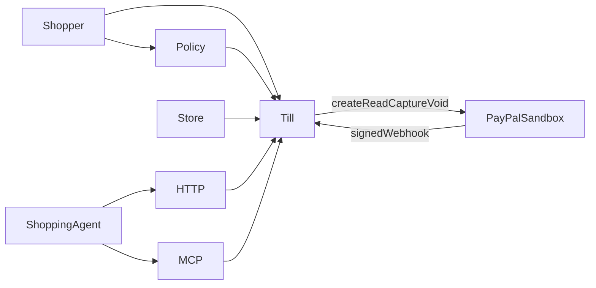
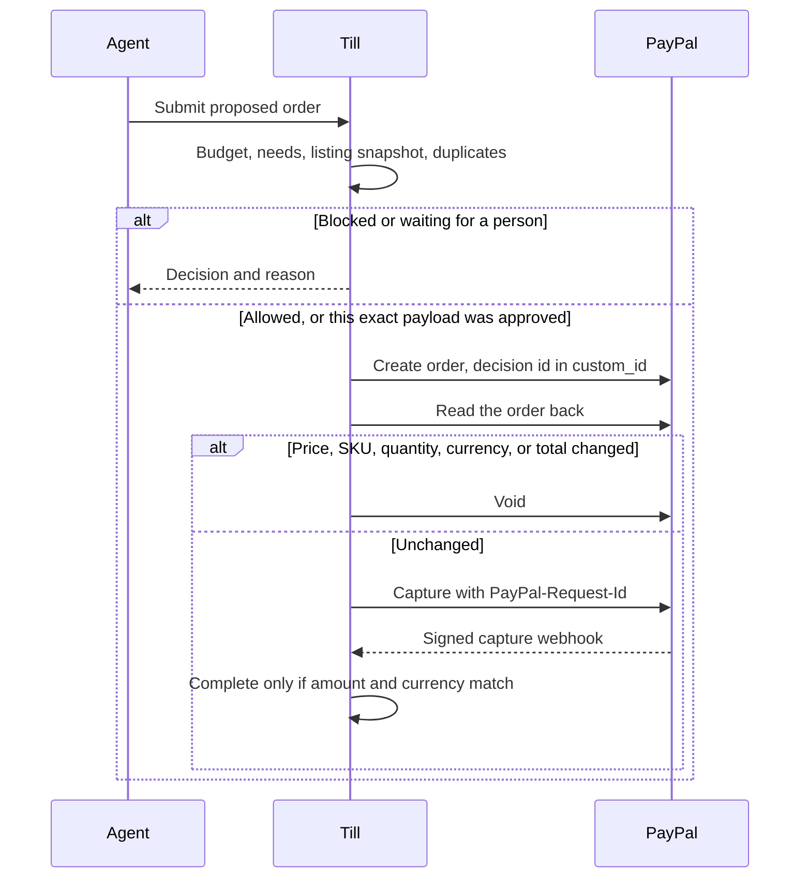
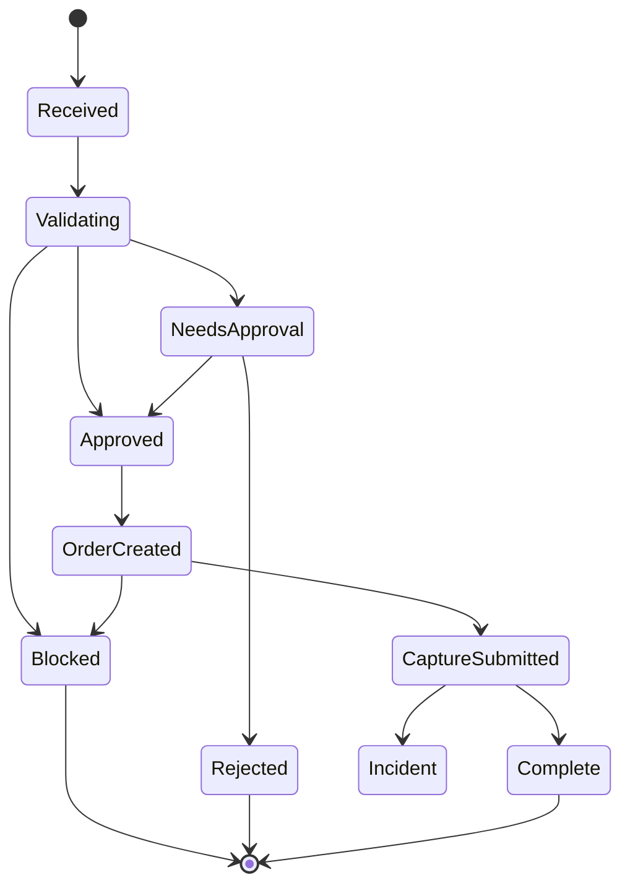

# Till

Till sits between a shopping agent and PayPal. The agent may choose an item. Only Till may create, read, capture, or void a PayPal order. A person opens Till to see each order: approval, success, where it failed, and whether the failure was malicious.

The agent has no PayPal credentials. It submits a proposed order. Till checks it, then talks to PayPal.

## Architecture

The shopper writes a policy, for example "running shoes, size 9, at most $80, no subscription." Our store gives Till the listing at decision time. Till compares four views: what was asked, what the agent claims, what was listed, and what PayPal will charge.

## Decision

Each proposal ends as `ALLOW`, `BLOCK`, or `NEED_APPROVAL`.

Hard rules cover budget, tamper, duplicates, and the phase-two checks below. An LLM judges whether the listing fits what the shopper asked, and writes that explanation. It cannot turn `BLOCK` into `ALLOW`, and it cannot call PayPal. If the model is down or not configured, hard rules still block, and the needs check becomes `NEED_APPROVAL`.

Amounts are integers in the smallest currency unit. Quantity times unit price, plus tax, shipping, and add-ons, must equal the total.

## First-version checks

- **Budget.** Per purchase, per day, and per category, on the full total. Above the ask-me line, wait for a person.
- **Needs.** An LLM compares the shopper's sentence with the listing and says fit, unfit, or unsure. Unfit blocks. Unsure waits for a person. This is not a string compare.
- **Tamper.** Snapshot the listing before any PayPal call. Read the order again before capture. A change in price, SKU, quantity, currency, or total voids it.
- **Duplicates.** One idempotency key pays once, enforced by a unique constraint in a single transaction. The same shopper, merchant, and SKU is also refused inside a time window. A captured PayPal order id cannot be paid again.

## Phase-two checks

These run in the same decision as the first-version checks, on both HTTP and MCP. They do not open a second way to pay.

- **Intent.** The shopper creates an intent by saving a policy sentence. Till issues that intent. A proposal must cite an unexpired intent. The agent cannot create one. A missing, expired, or unknown intent is `BLOCK`.
- **Subscription and protection plan.** A catalog line marked subscription or protection plan is not covered by an ordinary goods approval. It needs its own approval of that line. If the frozen policy excludes subscriptions, a subscription line is `BLOCK` instead of a request to approve.
- **New merchant.** The first order from a merchant that is not on the shopper's allowlist is `NEED_APPROVAL`. "Allow this merchant from now on" is what adds the merchant to that list.
- **Split and rapid charges.** Before the budget comparison, Till adds this proposal to the shopper's other non-rejected orders in a short window: the same intent, or the same merchant within 10 minutes. The sum is compared with the per-purchase cap and the daily cap. Over the cap is `BLOCK`. Each order still has its own idempotency key.
- **Untrusted page text.** Listing copy and any note from the agent are data, not rules. "Ignore the budget" in a description does not change the policy. The model may only add a stricter block. A model result that would allow a hard-rule block is discarded. The order page notes that the instruction was ignored.

## Authority

The agent may submit and read status. A logged-in shopper approves or rejects. Till captures only when the state machine says so. `approved`, `user_id`, and an amount sent by the agent grant nothing. The merchant is a catalog id.

Approval is a hash of amount, SKU, quantity, currency, and address. Any change expires it. Intents and approvals also expire by time. PayPal secrets stay on Till: not on the agent, the order page, or in logs. A failed signature check, a failed order read, or a required model timeout means no capture.

## PayPal

Sandbox Orders API. Create only after a decision allows it. Put the decision id in `custom_id`. Capture with `PayPal-Request-Id`. Read the order before capture. Listen for `CHECKOUT.ORDER.APPROVED`, `PAYMENT.CAPTURE.COMPLETED`, and `PAYMENT.CAPTURE.DENIED`.

Accept a webhook only after PayPal's signature check, and only if the certificate URL is PayPal's. Apply each event id once. Load the decision from `custom_id` and compare currency and amount. Mark complete only on a match. A mismatch, or a capture with no approved decision, is an incident; void the order if it is still open. An order id alone is not completion. Without a public URL, use PayPal's webhook simulator.

## Order page

A list, then one order:

- **Approval.** Pending, approved, rejected, or blocked. Bound to the payload that was shown.
- **Success.** Complete only after a verified webhook matches the amount.
- **Where it failed.** Budget, needs, listing versus PayPal, duplicate, webhook mismatch, missing intent, subscription or protection plan, new merchant, or combined charges. The page shows the four views and the total split into item, tax, shipping, and add-ons.
- **Malicious or not.** A changed price, swapped item, changed quantity, edited approval, repeated capture, webhook mismatch, or a set of charges that evade the cap is malicious. An ignored "ignore the budget" instruction is shown with that order. Over budget, a poor needs fit, a missing intent, a new merchant, or a subscription that needs its own approval is a policy block.

## Learning

Each order stores the intent, proposal, checks, explanation, policy version, PayPal order id, and outcome. Past orders stay tied to the policy version that judged them.

From a decision, the shopper may add one rule: allow this order once, allow this merchant from now on, or count shipping toward the cap. Only the merchant choice is an allowlist. The next order cites the decision that created the rule. Till does not train a model.

## State

`Complete` comes from a verified capture webhook whose amount matches the decision.

## Interfaces

HTTP and MCP call the same checkout functions. Neither can capture. The agent must not call PayPal directly.

- **HTTP**, used by the order page and our shopping agent. The agent submits a proposed order and reads status. Only a logged-in shopper can approve or reject.
- **MCP**, phase two. Two tools:
  - `submit_proposed_order` — catalog merchant id, line items, idempotency key, and intent id. Returns the decision id, status, and reason.
  - `get_decision` — decision id. Returns the same status the order page shows, without PayPal secrets.
  The agent authenticates with its own API key. That key cannot approve and cannot capture. A shopper still approves on the order page.

## Scope

The first version is one real sandbox purchase, blocks for the four checks, a verified webhook, the order page, and one shopper choice that applies on the next order. The demo agent is ours: an honest $74 pair of shoes, then a changed price, a swapped item, a changed quantity, and a second charge for the same shoes.

Phase two adds the five checks above and the MCP door. The same demo can then show a missing intent, a protection plan, a first order from a new merchant, three small charges that together pass the cap, a listing that says to ignore the budget, and one MCP submit that receives the same block as HTTP.

Till does not refund, answer disputes, fetch arbitrary merchant URLs, or train a fraud model. Stack: Python, FastAPI, SQLite.
