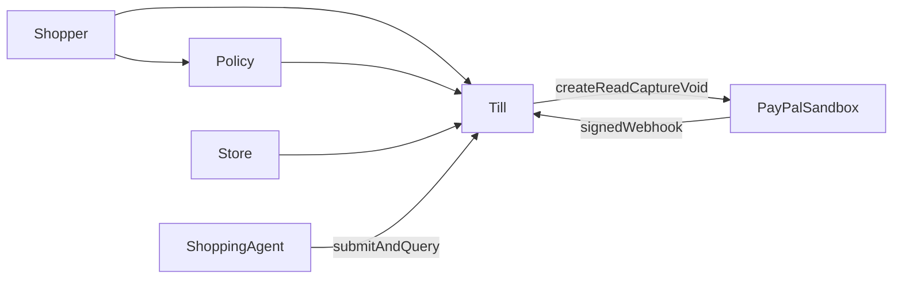
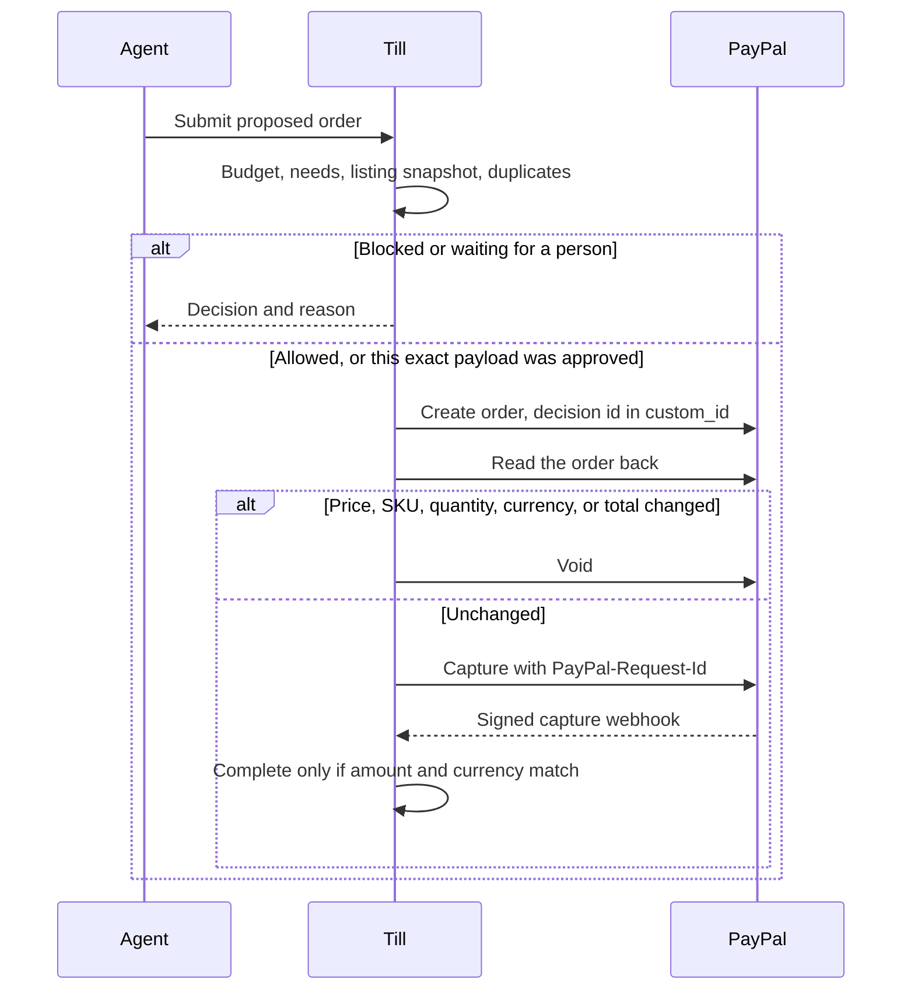
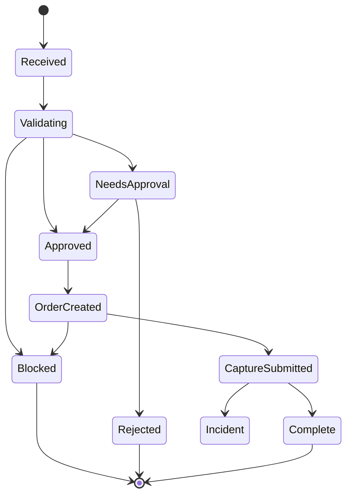

# Till

Till sits between a shopping agent and PayPal. The agent may choose an item. Only Till may create, read, capture, or void a PayPal order. A person opens Till to see each order: approval, success, where it failed, and whether the failure was malicious.

The agent has no PayPal credentials. It submits a proposed order. Till checks it, then talks to PayPal.

## Architecture

The shopper writes a policy, for example "running shoes, size 9, at most $80, no subscription." Our store gives Till the listing at decision time. Till compares four views: what was asked, what the agent claims, what was listed, and what PayPal will charge.

## Decision

Each proposal ends as `ALLOW`, `BLOCK`, or `NEED_APPROVAL`.

Hard rules cover budget, tamper, and duplicates. The model may parse the shopper's words, judge whether the item fits, and write a short explanation. It cannot turn `BLOCK` into `ALLOW`, and it cannot call PayPal. If the model is down, hard rules still block, and a needs check becomes `NEED_APPROVAL`.

Amounts are integers in the smallest currency unit. Quantity times unit price, plus tax, shipping, and add-ons, must equal the total.

## First-version checks

- **Budget.** Per purchase, per day, and per category, on the full total. Above the ask-me line, wait for a person.
- **Needs.** Freeze the shopper's sentence into category, size, brand, and exclusions. Compare with title, SKU, and category. If unsure, wait.
- **Tamper.** Snapshot the listing before any PayPal call. Read the order again before capture. A change in price, SKU, quantity, currency, or total voids it.
- **Duplicates.** One idempotency key pays once, enforced by a unique constraint in a single transaction. The same shopper, merchant, and SKU is also refused inside a time window. A captured PayPal order id cannot be paid again.

## Authority

The agent may submit and read status. A logged-in shopper approves or rejects. Till captures only when the state machine says so. `approved`, `user_id`, and an amount sent by the agent grant nothing. The merchant is a catalog id.

Approval is a hash of amount, SKU, quantity, currency, and address. Any change expires it. Intents and approvals also expire by time. PayPal secrets stay on Till: not on the agent, the order page, or in logs. A failed signature check, a failed order read, or a required model timeout means no capture.

## PayPal

Sandbox Orders API. Create only after a decision allows it. Put the decision id in `custom_id`. Capture with `PayPal-Request-Id`. Read the order before capture. Listen for `CHECKOUT.ORDER.APPROVED`, `PAYMENT.CAPTURE.COMPLETED`, and `PAYMENT.CAPTURE.DENIED`.

Accept a webhook only after PayPal's signature check, and only if the certificate URL is PayPal's. Apply each event id once. Load the decision from `custom_id` and compare currency and amount. Mark complete only on a match. A mismatch, or a capture with no approved decision, is an incident; void the order if it is still open. An order id alone is not completion. Without a public URL, use PayPal's webhook simulator.

## Order page

A list, then one order:

- **Approval.** Pending, approved, rejected, or blocked. Bound to the payload that was shown.
- **Success.** Complete only after a verified webhook matches the amount.
- **Where it failed.** Budget, needs, listing versus PayPal, duplicate, or webhook mismatch, with the four views and the total split into item, tax, shipping, and add-ons.
- **Malicious or not.** A changed price, swapped item, changed quantity, edited approval, repeated capture, or webhook mismatch is malicious. Over budget, or a poor needs fit, is a policy block.

## Learning

Each order stores the intent, proposal, checks, explanation, policy version, PayPal order id, and outcome. Past orders stay tied to the policy version that judged them.

From a decision, the shopper may add one rule: allow this order once, allow this merchant from now on, or count shipping toward the cap. Only the merchant choice is an allowlist. The next order cites the decision that created the rule. Till does not train a model.

## State

`Complete` comes from a verified capture webhook whose amount matches the decision.

## Interfaces

HTTP and MCP use the same checks. Neither can capture.

- **HTTP** in the first version, for the order page and our shopping agent.
- **MCP** after that loop works. Tools are submit proposed order and get decision. Capture is not a tool.

The agent must not call PayPal directly.

## Scope

The first version is one real sandbox purchase, blocks for the four checks, a verified webhook, the order page, and one shopper choice that applies on the next order. The demo agent is ours: an honest $74 pair of shoes, then a changed price, a swapped item, a changed quantity, and a second charge for the same shoes.

After that: refuse a payment with no intent; require separate approval for a subscription or protection plan; confirm the first order from a new merchant; add split orders and rapid small charges before the budget check; ignore product-page text that tries to change the rules; open the MCP door.

Till does not refund, answer disputes, fetch arbitrary merchant URLs, or train a fraud model. Stack: Python, FastAPI, SQLite.
